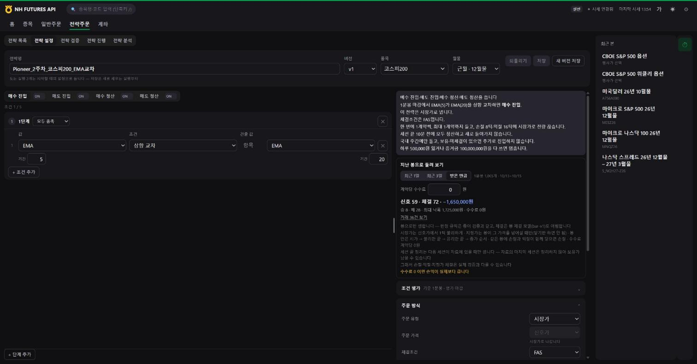
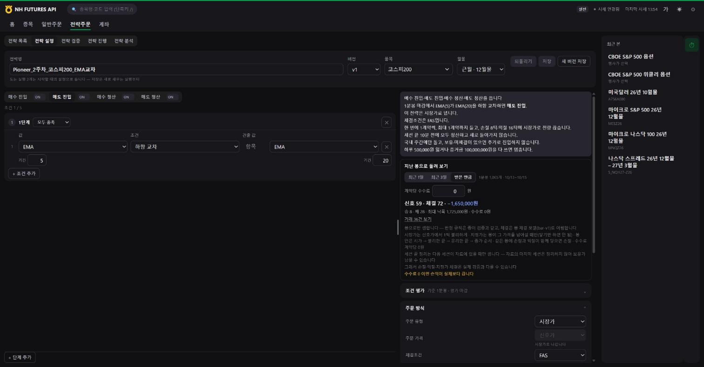
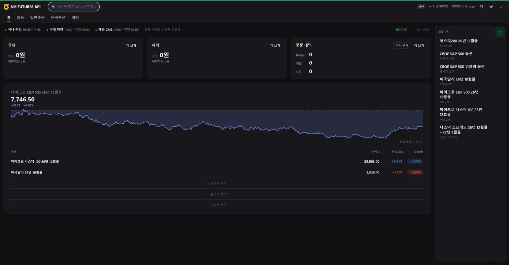
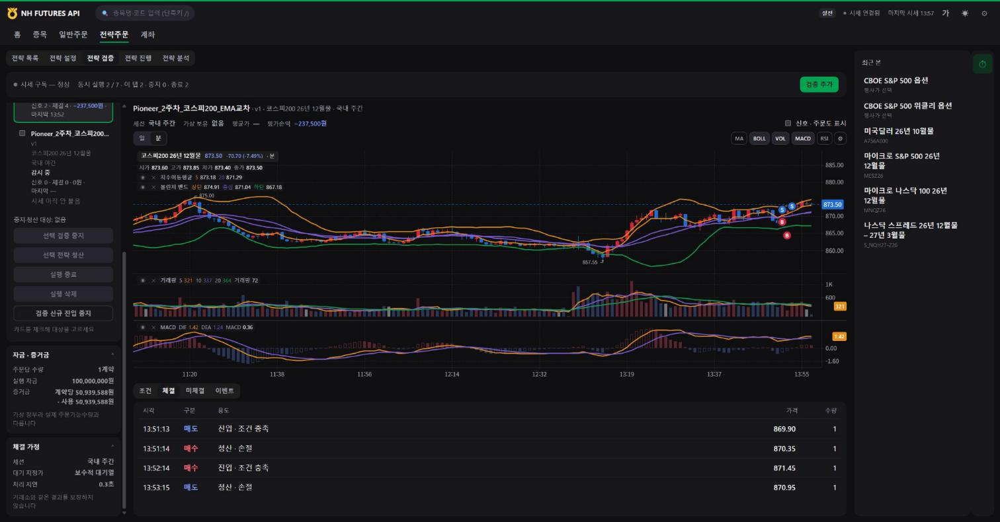
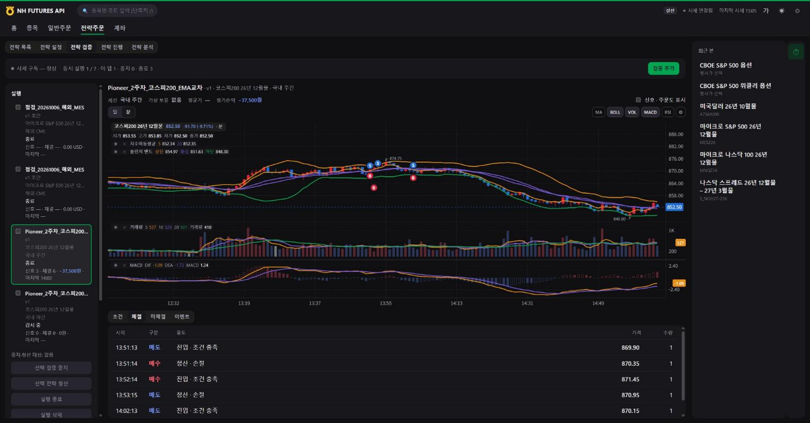
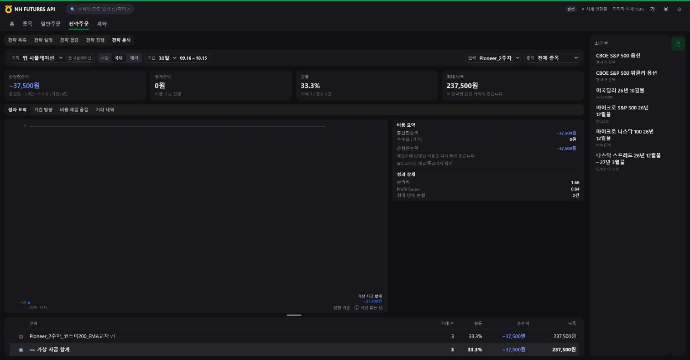
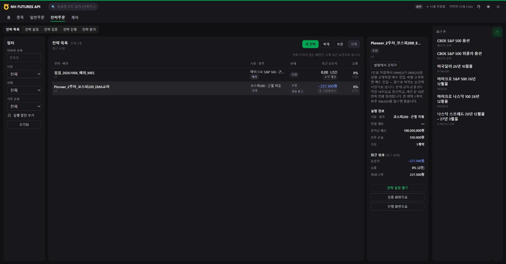
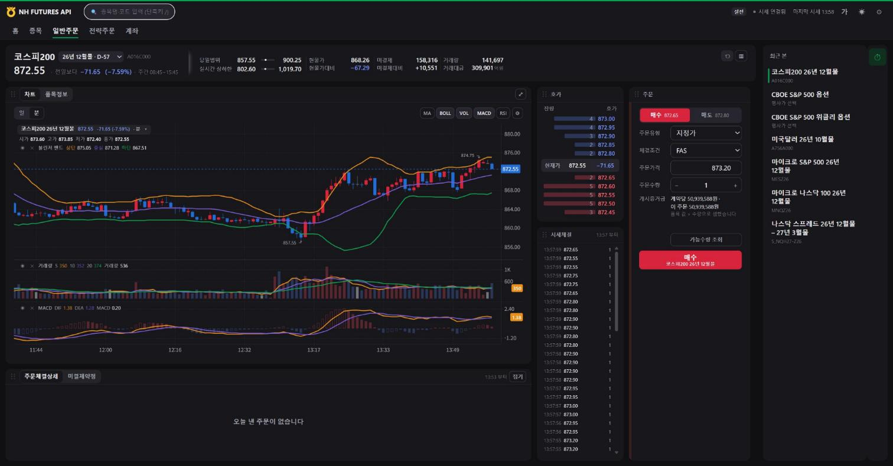

# 2주차 · 국내상품 전략 구현 — 코스피200 선물 1분봉 EMA 교차

**제출일: 2026/10/30(금)** · 마감 시각 미정

> 운영 담당자가 만든 **제출 예시**입니다. 이 README 하나가 2주차 보고서이며, 수치는 모두 `results/` 의 원본 파일에서 읽은 값입니다.
> 이 실행은 **앱 시뮬레이션**입니다. 실전 시세로 판정하지만 계좌에 주문을 내지 않았고, 체결은 앱의 종이 체결 모형이 계산한 값입니다. **모의계좌 체결이 아닙니다.**
> 국내 주간 실행은 2026-10-15 13:50:34 에 세워 15:03:32 에 운영자가 종료했습니다. 이 보고서의 실행 결과는 그 구간의 기록입니다.

| 항목 | 내용 |
| --- | --- |
| 전략 이름 | Pioneer_2주차_코스피200_EMA교차 |
| 전략 버전 id | `pioneer-w2-k200-ema-20261015` |
| 대상 종목 | 코스피200 선물 2026년 12월물 (`A016C000`) |
| 실행 환경 | 앱 시뮬레이션 — 실전 시세로 판정, 계좌 주문 없음, 종이 체결 |
| 작성일 | 2026-10-15 |

## 폴더 구성

| 경로 | 내용 |
| --- | --- |
| `README.md` | 이 보고서 |
| [strategy.json](strategy.json) | 앱에 저장한 전략 설정 그대로 (`version`·`draft`) |
| [summarize_journal.py](summarize_journal.py) | 실행 기록·백테스트 결과를 표로 바꾸는 스크립트 (Python 표준 라이브러리만 사용) |
| [results/](results/) | 원본 데이터 — 저장한 전략, 백테스트 답, 실행 상태 JSON |
| [screenshots/](screenshots/) | 실제 화면 캡처 |

## 1. 과제 요약

**과제:** NH선물 Open API 로 국내 선물·옵션 상품 하나에 대한 규칙 기반 전략을 구현하고, 실제로 실행한 기록으로 결과를 분석합니다.
수익률은 평가 기준이 아닙니다. 전략 실행, API 작동, 결과 분석, 오류와 개선, 재현성을 봅니다.

| 필수 기능 | 이 예시에서 한 것 | 근거 |
| --- | --- | --- |
| 시세 수신 | 국내 분봉 조회로 준비 봉을 받고, 실시간 체결·호가를 WebSocket 으로 수신 | 이벤트 「준비 봉 조회 1099줄」, 실행 상태 `feed: live` |
| 신호 판정 | 1분봉 마감에서 EMA(5)·EMA(20) 교차를 판정 | [strategy.json](strategy.json) |
| 주문 처리 | 계좌 주문 대신 앱 시뮬레이션(종이 체결 모형 `paper-v2`)으로 처리 | 실행 기록의 `record: paper`, `virtual: true` |
| 위험 관리 | 손절 8틱·익절 16틱·일일 손실 한도 500,000원·최대 보유 1계약·세션 끝 10분 전 정리 | [strategy.json](strategy.json) |
| 실행 기록 | 실행 id·시각·종목·설정과 신호·주문·체결·이벤트를 한 줄씩 기록 | [journal_run-pioneer-w2-day-20261015.jsonl](results/journal_run-pioneer-w2-day-20261015.jsonl) |

| 제출물 | 이 폴더의 위치 |
| --- | --- |
| 소스코드·실행 방법 | `strategy.json`, `summarize_journal.py`, 2절 |
| 보고서 | 이 README |
| 실행 근거 | `results/`, 6절 |
| 화면 캡처 | `screenshots/`, 6절 (인증정보·계좌 식별정보 없음) |

선택 기능으로는 백테스트와 실행 결과 비교, 주야간 세션 분리, 미체결·부분체결·거부·취소 처리, 호출 제한 대응, 결과 요약 스크립트를 예로 들었습니다. 이 예시는 백테스트와 요약 스크립트를 했고, 국내 야간 실행은 세워 두었지만 그 결과는 이 보고서에 싣지 않았습니다.
평가는 전략 실행·API 작동·결과 분석(손실도 분석 대상)·오류와 개선·재현성의 관점으로 보며, 세부 배점은 운영기획안의 예시일 뿐 확정이 아닙니다.

테스트 원칙은 다음과 같습니다. 실전 계좌 주문은 하지 않습니다. 시뮬레이션 체결을 모의계좌 체결로 표현하지 않습니다. 주문 접수만 있으면 체결 성공으로 적지 않습니다. 실제로 발생한 오류만 적습니다.

## 2. 실행 방법

### 2-1. 앱 설치

[NH FUTURES API](https://github.com/NHFutures-OpenAPI/nh-futures-open-api) 저장소의 설치 안내를 따라 설치하고, 국내 APP Key·Secret Key 를 앱 설정 화면에 입력합니다.
전략 판정·종이 체결·백테스트는 이 앱의 전략주문 탭이 수행합니다.

### 2-2. 전략 재현

**방법 1. 전략 설정 화면에서 같은 조건을 넣기** — 전략주문 탭에서 새 전략을 만들고 3절의 값을 넣어 저장합니다.
그다음 「백테스트」에서 받은 만큼의 지난 봉으로 돌려 보고, 「전략 검증」에서 **앱 시뮬레이션**으로 실행을 세웁니다.

**방법 2. `strategy.json` 을 저장 API 로 넣기** — 앱이 켜져 있을 때, 앱의 로컬 주소로 파일을 그대로 보냅니다.
포트는 앱 창의 주소에서 확인합니다(아래 `8000` 은 예시).

```bash
curl -X PUT "http://127.0.0.1:8000/api/strategy/versions/pioneer-w2-k200-ema-20261015" \
  -H "Content-Type: application/json" \
  --data-binary @strategy.json
```

`strategy.json` 은 특정 월물 코드 대신 품목(코스피200 선물)만 들고 있고, 종목코드는 앱이 그때의 종목 마스터에서 찾습니다.
이 보고서의 실행은 2026년 12월물(`A016C000`)로 돌았습니다. 월물이 바뀐 뒤에 재현하면 다른 월물로 돌게 되어 결과가 달라집니다.

### 2-3. 요약 스크립트

`week02/` 폴더에서 실행합니다. Python 3.10 이상이면 추가 설치가 필요 없습니다. 결과 표는 표준 출력으로 나오고, `--out 파일.md` 를 주면 파일로도 씁니다.

```bash
# 국내 주간 실행 기록 요약 (저장소 안의 거른 기록 파일)
python summarize_journal.py --journal results/journal_run-pioneer-w2-day-20261015.jsonl --run run-pioneer-w2-day-20261015 --status "확정 — 15:03:32 운영자 종료까지의 기록"

# 백테스트 요약
python summarize_journal.py --backtest results/backtest_all_20261015_135033.json

# (참고) 앱의 원본 기록 파일에서 바로 읽을 때: --journal "%USERPROFILE%/NHFutures/state/strategy-trades.jsonl"
```

- `results/journal_*.jsonl` 은 앱의 원본 기록 파일에서 그 실행의 줄만 그대로 골라 낸 사본입니다.
- 기록 파일은 **읽기만** 합니다. 다른 실행의 줄이 섞여 있어도 `--run` 으로 거릅니다. `--status` 를 빼면 맨 위에 「진행 중」이 표시됩니다.
- 손익은 기록에 적힌 `grossPl`·`fee`·`netPl`(백테스트는 `pl`)을 그대로 쓰고 더하기만 합니다.
- 시각은 모두 한국 시간(KST)으로 바꿔 적습니다. 금액은 원 단위로 반올림해 표시합니다.

## 3. 전략과 매매 계획

### 3-1. 대상 상품

| 항목 | 값 | 출처 (실행 상태 칸) |
| --- | --- | --- |
| 종목 | 코스피200 선물 2026년 12월물 `A016C000` | `code` |
| 호가 단위 | 0.05 포인트 | `tickSize` |
| 거래승수 | 250,000원 | `multiplier` |
| 1틱 가치 | 12,500원 (0.05 × 250,000) | 위 두 값으로 계산 |
| 위탁증거금률 / 유지증거금률 | 21.75% / 14.50% | `initialMarginRate` · `maintenanceMarginRate` |
| 계약당 증거금 | 50,939,587.5원 | `perContract` (`perContractBasis: margin`) |
| 남은 만기일 수 | 57일 (실행을 세운 날 기준) | `daysLeft` |

국내 대표 지수선물로 거래가 많고 주간·야간 세션이 모두 있어, 실시간 시세 수신과 세션 처리를 함께 확인하기 좋다고 판단했습니다.

### 3-2. 매매 규칙

| 구분 | 조건 |
| --- | --- |
| 기준 봉 / 판정 | 1분봉, 봉 마감 때 판정 |
| 매수 진입 | EMA(5) 가 EMA(20) 을 **상향 교차** |
| 매도 진입 | EMA(5) 가 EMA(20) 을 **하향 교차** |
| 매수 청산 | EMA(5) 가 EMA(20) 을 하향 교차 |
| 매도 청산 | EMA(5) 가 EMA(20) 을 상향 교차 |
| 손절 / 익절 | 진입가에서 불리하게 8틱 / 유리하게 16틱 |
| 세션 끝 정리 | 세션 끝 10분 전 전량 청산 |
| 주문 | 시장가, FAS, 1계약 |
| 최대 보유 | 1계약, 보유 중 추가 진입 안 함 |
| 일일 손실 한도 | 500,000원 (닿으면 그날 새 진입을 막음) |
| 증거금 예산 | 100,000,000원 |

짧은 이동평균이 긴 이동평균을 넘어서는 순간을 추세 전환의 신호로 보는, 가장 단순한 추세 추종 규칙입니다.
손익비를 1:2(손절 8틱, 익절 16틱)로 두어, 승률이 낮아도 이익 거래가 손실을 메우도록 설계했습니다.
과제의 목적이 「규칙을 정확히 구현하고 기록하는 것」이라 조건을 일부러 단순하게 두었습니다.





## 4. 사용 API와 프로그램 구조

### 4-1. 구조

```
[NH선물 Open API]
   ├─ REST      : 인증, 국내 분봉 조회, 국내 품목별 세부정보
   └─ WebSocket : 국내 실시간 체결·호가
        ↓
[NH FUTURES API 앱 — 전략주문 탭]
   전략 설정(저장) → 백테스트(bar-v1) → 앱 시뮬레이션 실행(paper-v2)
        ↓
[실행 기록 파일 strategy-trades.jsonl]  한 줄 = 한 사건
        ↓
[summarize_journal.py]  기록 → 표
```

### 4-2. 사용 API

| 용도 | API 명 (명세 문서) | 방식 |
| --- | --- | --- |
| 접근 토큰 발급 | 접근토큰 발급 (`common_auth/token`) | REST |
| WebSocket 접속키 발급 | 웹소켓 키 발급 (`common_auth/web-socket-key`) | REST |
| 준비 봉·백테스트용 지난 봉 | 국내_차트(분) (`domestic_chart-minute`) | REST |
| 호가 단위·증거금률·거래시간 | 국내_품목별세부정보 (`domestic_product-detail`) | REST |
| 주간 실시간 체결 | 국내_시세체결 (`KA`) | WebSocket |
| 주간 실시간 호가 | 국내_시세호가 (`KB`) | WebSocket |
| 야간 실시간 체결·호가 | 국내_시세체결(야간) `KC` · 국내_시세호가(야간) `KD` | WebSocket |

주문 API(`domestic_order` 등)는 **호출하지 않았습니다.** 이 실행은 앱 시뮬레이션이라 주문을 계좌로 보내지 않습니다.
종목코드와 거래승수는 NH선물이 제공하는 종목 마스터 파일에서 읽습니다.

### 4-3. 기록 형식

앱의 실행 기록 파일(`%USERPROFILE%\NHFutures\state\strategy-trades.jsonl`)은 한 줄이 한 사건(JSON)이고, 여러 실행의 줄이 섞여 있습니다.

| 갈래 | 담긴 것 |
| --- | --- |
| `event` | 실행 세움·준비 봉·신호·상태 변화·주문 의도·체결 알림·공백·세션 끝 |
| `order` | 끝난 주문 한 건: 방향·진입/청산·까닭·유형·수량·채운 수량·결과 |
| `fill` | 종이 체결 한 건: 시각·가격·수량·까닭·신호 봉의 지표값·모형 이름 |
| `trade` | 진입~청산 한 건: 평균 진입가·청산가·`grossPl`·`fee`·`netPl` |
| `day` | 거래일을 넘길 때의 잔고 |

## 5. 실행 환경

| 항목 | 내용 |
| --- | --- |
| 환경 | **앱 시뮬레이션** — 실전 시세로 판정하고 종이 체결 모형으로 체결을 계산 |
| 계좌 주문 | **없음.** 모의계좌 주문도 아니며, 이 보고서의 체결은 모의계좌 체결이 아님 |
| 가상 자금 | 100,000,000원 |
| 수수료 | 0원 (설정값) |
| 국내 주간 실행 | `run-pioneer-w2-day-20261015` — 2026-10-15 13:50:34 KST 세움 |
| 국내 주간 실행 종료 | 2026-10-15 15:03:32 KST 운영자 종료 (세션 끝 정리 시각 15:35 전) |
| 국내 야간 실행 | `run-pioneer-w2-night-20261015` — 2026-10-15 13:51:18 KST 세움, 18:00 야간 세션부터 판정 (결과는 이 보고서에 싣지 않음) |
| 준비 봉 | 주간 1,099개 · 야간 1,750개 (지표 준비에 필요한 봉 40개) |
| 백테스트 | 2026-10-15 13:50 실행, 봉 체결 모형 `bar-v1` |
| 시간대 | 모든 시각은 한국 시간(KST) |



상단의 「실전」 배지는 시세를 받는 접속 환경 표시입니다. 이 실행은 계좌 주문을 내지 않습니다. ([상단 확대](screenshots/07b-홈-상단바-확대-1358.png))

## 6. 실행 결과

### 6-1. 근거 파일 (`results/`)

| 파일 | 내용 |
| --- | --- |
| [strategy_version_saved.json](results/strategy_version_saved.json) | 앱이 저장한 전략 전체 |
| [backtest_all_20261015_135033.json](results/backtest_all_20261015_135033.json) | 백테스트 답 전체 (거래·가정 포함) |
| [run_added_run-pioneer-w2-day-20261015.json](results/run_added_run-pioneer-w2-day-20261015.json) | 주간 실행을 세운 직후의 실행 상태 |
| [run_added_run-pioneer-w2-night-20261015.json](results/run_added_run-pioneer-w2-night-20261015.json) | 야간 실행을 세운 직후의 실행 상태 |
| [snapshot_run-pioneer-w2-day-20261015_20261015_135039.json](results/snapshot_run-pioneer-w2-day-20261015_20261015_135039.json) | 주간 실행 13:50:39 시점 한 벌 (실행·체결·이벤트·거래·곡선) |
| [snapshot_run-pioneer-w2-day-20261015_final_20261015_150332.json](results/snapshot_run-pioneer-w2-day-20261015_final_20261015_150332.json) | 주간 실행 종료 직전 한 벌 |
| [snapshot_run-pioneer-w2-day-20261015_ended_20261015_150332.json](results/snapshot_run-pioneer-w2-day-20261015_ended_20261015_150332.json) | 주간 실행 종료 뒤 한 벌 (상태 「종료」) |
| [journal_run-pioneer-w2-day-20261015.jsonl](results/journal_run-pioneer-w2-day-20261015.jsonl) | 국내 주간 실행의 기록 줄만 거른 사본 45줄 (event 30 · fill 6 · order 6 · trade 3) |

### 6-2. 백테스트 결과 (지난 봉)

| 항목 | 값 |
| --- | --- |
| 체결 모형 | `bar-v1` |
| 봉 범위 | 2026-10-12 09:24 ~ 2026-10-15 13:49 (4세션, 판정 1,470봉 · 받은 봉 1,509 · 지표 준비 40) |
| 슬리피지 / 수수료 | 1틱(불리한 쪽) / 0원 |
| 신호 수 | 84 |
| 체결 수 | 104 (진입 52 + 청산 52) |
| 거래 수 | 52 (매수 26 · 매도 26) |
| 승 / 패 | 12 / 40 |
| 승률 | 23.1% |
| 순손익 | **−2,250,000원** (JSON 값 −2,249,999.99…, 부동소수 오차) |
| 최대 낙폭 | 2,362,500원 |
| 평균 이익 / 평균 손실 | +187,500원 / −112,500원 |
| 끝에 남은 보유 | 없음 |

청산 까닭별 건수:

| 청산 까닭 | 건수 |
| --- | --- |
| 손절 | 40 |
| 익절 | 12 |
| 반대 교차 | 0 |
| 세션 끝 정리 | 0 |
| 진입한 봉 안에서 바로 청산 | 49 / 52 (나머지 3건은 1~2분 뒤 손절) |

거래일별 결과 (청산 시각 기준):

| 거래일 | 거래 | 승 | 패 | 순손익 |
| --- | --- | --- | --- | --- |
| 2026-10-12 | 16 | 4 | 12 | −600,000원 |
| 2026-10-13 | 8 | 1 | 7 | −600,000원 |
| 2026-10-14 | 18 | 5 | 13 | −525,000원 |
| 2026-10-15 (13:49까지) | 10 | 2 | 8 | −525,000원 |

<details>
<summary>백테스트 가정 (<code>assumptions</code>) 전체</summary>

| 뜻 | 키 | 값 |
| --- | --- | --- |
| 체결 지연(초) | `delay` | 0 |
| 슬리피지(틱, 불리한 쪽) | `slippageTicks` | 1 |
| 지정가 체결 조건 | `limitFill` | through |
| 한 봉에 손절·익절이 함께 닿으면 손절 | `sameBarStopFirst` | true |
| 봉 안의 가격 경로 | `path` | open-adverse-favorable-close |
| 세션 끝 처리 | `sessionEnd` | followed-sessions-only |
| 일봉 신호 주문 시점 | `dailyOrders` | next-session-first-trade |
| 일봉 신호 가격 기준 | `dailyPriceBasis` | signal-close |
| 신규 진입 막는 만기일 | `expiryBlock` | 2026-12-10 |
| 계약당 수수료 | `feePerContract` | 0.0 |
| 판정 기준 | `evalBasis` | bar-close |
| 판정하지 못한 조건 | `unjudged` | [] |
| 일봉 진입 시간 | `dailyEntryWindow` | null |
| 증거금 예산 검사 건너뜀 | `budgetUnchecked` | false |
| 건너뛴 까닭 | `budgetUncheckedWhy` | null |
| 세션 끝 정리 | `sessionEndFlat` | followed-sessions-only |

</details>

<details>
<summary>백테스트 거래 52건 전체</summary>

| # | 진입 봉 | 청산 봉 | 방향 | 수량 | 진입가 | 청산가 | 청산 까닭 | 총손익 | 수수료 | 순손익 | 보유시간 |
| --- | --- | --- | --- | --- | --- | --- | --- | --- | --- | --- | --- |
| 1 | 2026-10-12 09:31:00 | 2026-10-12 09:31:00 | 매도 | 1 | 1035.70 | 1036.15 | 손절 | -112,500 | 0 | -112,500 | 같은 봉 |
| 2 | 2026-10-12 09:32:00 | 2026-10-12 09:32:00 | 매수 | 1 | 1038.75 | 1038.30 | 손절 | -112,500 | 0 | -112,500 | 같은 봉 |
| 3 | 2026-10-12 09:38:00 | 2026-10-12 09:38:00 | 매도 | 1 | 1036.65 | 1035.90 | 익절 | 187,500 | 0 | 187,500 | 같은 봉 |
| 4 | 2026-10-12 10:31:00 | 2026-10-12 10:31:00 | 매수 | 1 | 1021.95 | 1021.50 | 손절 | -112,500 | 0 | -112,500 | 같은 봉 |
| 5 | 2026-10-12 10:33:00 | 2026-10-12 10:33:00 | 매도 | 1 | 1019.55 | 1020.00 | 손절 | -112,500 | 0 | -112,500 | 같은 봉 |
| 6 | 2026-10-12 10:34:00 | 2026-10-12 10:34:00 | 매수 | 1 | 1020.90 | 1021.65 | 익절 | 187,500 | 0 | 187,500 | 같은 봉 |
| 7 | 2026-10-12 11:04:00 | 2026-10-12 11:04:00 | 매도 | 1 | 1026.65 | 1025.90 | 익절 | 187,500 | 0 | 187,500 | 같은 봉 |
| 8 | 2026-10-12 11:24:00 | 2026-10-12 11:25:00 | 매수 | 1 | 1026.65 | 1026.20 | 손절 | -112,500 | 0 | -112,500 | 1분 0초 |
| 9 | 2026-10-12 11:36:00 | 2026-10-12 11:36:00 | 매도 | 1 | 1024.75 | 1025.20 | 손절 | -112,500 | 0 | -112,500 | 같은 봉 |
| 10 | 2026-10-12 12:26:00 | 2026-10-12 12:26:00 | 매수 | 1 | 1022.20 | 1021.75 | 손절 | -112,500 | 0 | -112,500 | 같은 봉 |
| 11 | 2026-10-12 12:33:00 | 2026-10-12 12:33:00 | 매도 | 1 | 1020.10 | 1020.55 | 손절 | -112,500 | 0 | -112,500 | 같은 봉 |
| 12 | 2026-10-12 13:07:00 | 2026-10-12 13:07:00 | 매수 | 1 | 1017.90 | 1017.45 | 손절 | -112,500 | 0 | -112,500 | 같은 봉 |
| 13 | 2026-10-12 13:12:00 | 2026-10-12 13:12:00 | 매도 | 1 | 1016.30 | 1015.55 | 익절 | 187,500 | 0 | 187,500 | 같은 봉 |
| 14 | 2026-10-12 13:19:00 | 2026-10-12 13:19:00 | 매수 | 1 | 1017.60 | 1017.15 | 손절 | -112,500 | 0 | -112,500 | 같은 봉 |
| 15 | 2026-10-12 13:23:00 | 2026-10-12 13:23:00 | 매도 | 1 | 1015.80 | 1016.25 | 손절 | -112,500 | 0 | -112,500 | 같은 봉 |
| 16 | 2026-10-12 13:27:00 | 2026-10-12 13:27:00 | 매수 | 1 | 1016.90 | 1016.45 | 손절 | -112,500 | 0 | -112,500 | 같은 봉 |
| 17 | 2026-10-13 09:51:00 | 2026-10-13 09:51:00 | 매수 | 1 | 962.95 | 962.50 | 손절 | -112,500 | 0 | -112,500 | 같은 봉 |
| 18 | 2026-10-13 09:53:00 | 2026-10-13 09:53:00 | 매도 | 1 | 958.15 | 957.40 | 익절 | 187,500 | 0 | 187,500 | 같은 봉 |
| 19 | 2026-10-13 10:12:00 | 2026-10-13 10:12:00 | 매수 | 1 | 961.20 | 960.75 | 손절 | -112,500 | 0 | -112,500 | 같은 봉 |
| 20 | 2026-10-13 10:17:00 | 2026-10-13 10:17:00 | 매도 | 1 | 951.85 | 952.30 | 손절 | -112,500 | 0 | -112,500 | 같은 봉 |
| 21 | 2026-10-13 10:55:00 | 2026-10-13 10:55:00 | 매수 | 1 | 942.95 | 942.50 | 손절 | -112,500 | 0 | -112,500 | 같은 봉 |
| 22 | 2026-10-13 10:56:00 | 2026-10-13 10:56:00 | 매도 | 1 | 939.20 | 939.65 | 손절 | -112,500 | 0 | -112,500 | 같은 봉 |
| 23 | 2026-10-13 11:05:00 | 2026-10-13 11:05:00 | 매수 | 1 | 941.40 | 940.95 | 손절 | -112,500 | 0 | -112,500 | 같은 봉 |
| 24 | 2026-10-13 11:22:00 | 2026-10-13 11:22:00 | 매도 | 1 | 941.35 | 941.80 | 손절 | -112,500 | 0 | -112,500 | 같은 봉 |
| 25 | 2026-10-14 09:43:00 | 2026-10-14 09:43:00 | 매도 | 1 | 965.80 | 966.25 | 손절 | -112,500 | 0 | -112,500 | 같은 봉 |
| 26 | 2026-10-14 10:38:00 | 2026-10-14 10:38:00 | 매수 | 1 | 955.50 | 955.05 | 손절 | -112,500 | 0 | -112,500 | 같은 봉 |
| 27 | 2026-10-14 10:39:00 | 2026-10-14 10:39:00 | 매도 | 1 | 952.80 | 952.05 | 익절 | 187,500 | 0 | 187,500 | 같은 봉 |
| 28 | 2026-10-14 10:51:00 | 2026-10-14 10:51:00 | 매수 | 1 | 956.10 | 955.65 | 손절 | -112,500 | 0 | -112,500 | 같은 봉 |
| 29 | 2026-10-14 11:16:00 | 2026-10-14 11:16:00 | 매도 | 1 | 957.85 | 957.10 | 익절 | 187,500 | 0 | 187,500 | 같은 봉 |
| 30 | 2026-10-14 11:23:00 | 2026-10-14 11:23:00 | 매수 | 1 | 960.80 | 960.35 | 손절 | -112,500 | 0 | -112,500 | 같은 봉 |
| 31 | 2026-10-14 11:37:00 | 2026-10-14 11:37:00 | 매도 | 1 | 959.65 | 958.90 | 익절 | 187,500 | 0 | 187,500 | 같은 봉 |
| 32 | 2026-10-14 11:42:00 | 2026-10-14 11:42:00 | 매수 | 1 | 961.05 | 961.80 | 익절 | 187,500 | 0 | 187,500 | 같은 봉 |
| 33 | 2026-10-14 12:05:00 | 2026-10-14 12:05:00 | 매도 | 1 | 961.60 | 962.05 | 손절 | -112,500 | 0 | -112,500 | 같은 봉 |
| 34 | 2026-10-14 12:12:00 | 2026-10-14 12:12:00 | 매수 | 1 | 964.15 | 963.70 | 손절 | -112,500 | 0 | -112,500 | 같은 봉 |
| 35 | 2026-10-14 12:23:00 | 2026-10-14 12:25:00 | 매도 | 1 | 962.65 | 963.10 | 손절 | -112,500 | 0 | -112,500 | 2분 0초 |
| 36 | 2026-10-14 13:01:00 | 2026-10-14 13:02:00 | 매수 | 1 | 959.75 | 959.30 | 손절 | -112,500 | 0 | -112,500 | 1분 0초 |
| 37 | 2026-10-14 13:11:00 | 2026-10-14 13:11:00 | 매도 | 1 | 957.90 | 958.35 | 손절 | -112,500 | 0 | -112,500 | 같은 봉 |
| 38 | 2026-10-14 13:24:00 | 2026-10-14 13:24:00 | 매수 | 1 | 958.00 | 957.55 | 손절 | -112,500 | 0 | -112,500 | 같은 봉 |
| 39 | 2026-10-14 13:25:00 | 2026-10-14 13:25:00 | 매도 | 1 | 956.55 | 955.80 | 익절 | 187,500 | 0 | 187,500 | 같은 봉 |
| 40 | 2026-10-14 13:32:00 | 2026-10-14 13:32:00 | 매수 | 1 | 957.50 | 957.05 | 손절 | -112,500 | 0 | -112,500 | 같은 봉 |
| 41 | 2026-10-14 13:37:00 | 2026-10-14 13:37:00 | 매도 | 1 | 956.10 | 956.55 | 손절 | -112,500 | 0 | -112,500 | 같은 봉 |
| 42 | 2026-10-14 13:52:00 | 2026-10-14 13:52:00 | 매수 | 1 | 958.30 | 957.85 | 손절 | -112,500 | 0 | -112,500 | 같은 봉 |
| 43 | 2026-10-15 08:46:00 | 2026-10-15 08:46:00 | 매도 | 1 | 886.00 | 886.45 | 손절 | -112,500 | 0 | -112,500 | 같은 봉 |
| 44 | 2026-10-15 10:33:00 | 2026-10-15 10:33:00 | 매수 | 1 | 868.60 | 868.15 | 손절 | -112,500 | 0 | -112,500 | 같은 봉 |
| 45 | 2026-10-15 10:34:00 | 2026-10-15 10:34:00 | 매도 | 1 | 866.65 | 867.10 | 손절 | -112,500 | 0 | -112,500 | 같은 봉 |
| 46 | 2026-10-15 10:37:00 | 2026-10-15 10:37:00 | 매수 | 1 | 869.30 | 868.85 | 손절 | -112,500 | 0 | -112,500 | 같은 봉 |
| 47 | 2026-10-15 10:47:00 | 2026-10-15 10:47:00 | 매도 | 1 | 864.60 | 863.85 | 익절 | 187,500 | 0 | 187,500 | 같은 봉 |
| 48 | 2026-10-15 11:07:00 | 2026-10-15 11:07:00 | 매수 | 1 | 866.80 | 867.55 | 익절 | 187,500 | 0 | 187,500 | 같은 봉 |
| 49 | 2026-10-15 11:27:00 | 2026-10-15 11:27:00 | 매도 | 1 | 868.20 | 868.65 | 손절 | -112,500 | 0 | -112,500 | 같은 봉 |
| 50 | 2026-10-15 11:56:00 | 2026-10-15 11:56:00 | 매수 | 1 | 865.35 | 864.90 | 손절 | -112,500 | 0 | -112,500 | 같은 봉 |
| 51 | 2026-10-15 12:01:00 | 2026-10-15 12:01:00 | 매도 | 1 | 862.45 | 862.90 | 손절 | -112,500 | 0 | -112,500 | 같은 봉 |
| 52 | 2026-10-15 12:08:00 | 2026-10-15 12:08:00 | 매수 | 1 | 866.05 | 865.60 | 손절 | -112,500 | 0 | -112,500 | 같은 봉 |

</details>


**위 캡처의 수치가 이 절의 표와 다른 까닭.** 캡처의 「받은 만큼」은 캡처 시점에 화면이 들고 있던 1분봉 1,065개(10/13~10/15)로 센 값입니다.
위 표는 서버가 국내_차트(분) 조회로 받은 1,470봉(4세션)으로 센 값입니다. 둘 다 같은 가정(`bar-v1`·슬리피지 1틱·수수료 0원)의 실제 결과이며, 봉 범위만 다릅니다.
화면에는 「수수료 0 이면 손익이 실제보다 큽니다」 경고도 보입니다. ([결과 칸 확대](screenshots/04b-백테스트-받은만큼-확대-1356.png))

| 구분 | 봉 | 신호 | 체결 | 승 / 패 | 순손익 | 최대 낙폭 |
| --- | --- | --- | --- | --- | --- | --- |
| 위 표 (JSON) | 1,470 | 84 | 104 | 12 / 40 | −2,250,000원 | 2,362,500원 |
| 캡처 (화면) | 1,065 | 59 | 72 | 8 / 28 | −1,650,000원 | 1,725,000원 |

### 6-3. 국내 주간 앱 시뮬레이션 결과

`results/journal_run-pioneer-w2-day-20261015.jsonl` 을 요약 스크립트로 정리한 값입니다. 체결은 모두 **종이 체결**이며 계좌 주문은 없습니다.

| 항목 | 값 |
| --- | --- |
| 실행 시작 ~ 종료 | 2026-10-15 13:50:34 ~ 15:03:32 KST (운영자 종료) |
| 신호 / 종이 체결 / 거래 | 3 / 6 / 3 (매도 2 · 매수 1) |
| 승 / 패 | 1 / 2 |
| 순손익 / 수수료 | **−37,500원** / 0원 |
| 최대 낙폭 (실현 누적 기준) | 237,500원 (누적 −112,500 → −237,500 → −37,500) |
| 청산 까닭별 건수 | 손절 2 · 익절 1 · 반대 교차 0 · 세션 끝 정리 0 |
| 미체결 · 거부 · 취소 | 0 · 0 · 0 (주문 6건 모두 전량 종이 체결) |
| 데이터 공백 · 오류 이벤트 | 0 (이벤트 30줄 = 상태 변화 14 · 주문 6 · 체결 6 · 신호 3 · 준비 봉 1) |
| 종료 시 보유 · 평가손익 | 0계약 · 0원, 마지막 현재가 854.55 |
| 세션 끝 정리 | 작동하지 않음 — 정리 시각(15:35) 전인 15:03:32 에 운영자가 종료 |

거래 3건:

| # | 진입 | 청산 | 방향 | 진입가 | 청산가 | 청산 까닭 | 순손익 | 보유시간 |
| --- | --- | --- | --- | --- | --- | --- | --- | --- |
| 1 | 13:51:13 | 13:51:14 | 매도 | 869.90 | 870.35 | 손절 | −112,500원 | 1초 |
| 2 | 13:52:14 | 13:53:15 | 매수 | 871.45 | 870.95 | 손절 | −125,000원 | 1분 1초 |
| 3 | 14:02:13 | 14:02:24 | 매도 | 870.15 | 869.35 | 익절 | +200,000원 | 11초 |

신호 봉 종가와 진입 종이 체결가:

| # | 신호 시각 | 신호 봉 종가 | 진입 체결가 |
| --- | --- | --- | --- |
| 1 | 13:51:12 매도 진입 | 868.10 | 869.90 |
| 2 | 13:52:13 매수 진입 | 871.15 | 871.45 |
| 3 | 14:02:12 매도 진입 | 870.30 | 870.15 |

<details>
<summary>주간 실행 이벤트 30줄 전체</summary>

| 시각 | 갈래 | 글 |
| --- | --- | --- |
| 13:50:34 | state | 검증 실행을 세웠습니다 |
| 13:50:34 | ready | 준비 봉 조회 1099줄 — 새 봉 1099개(지금 1099개) |
| 13:51:12 | signal | 매도 진입 규칙이 걸렸습니다 |
| 13:51:12 | state | 진입 주문 중 |
| 13:51:12 | order | sell 1계약 시장가 시장가 |
| 13:51:13 | fill | 1계약 869.9 체결 |
| 13:51:13 | state | 보유 중 |
| 13:51:14 | state | 청산 요청 |
| 13:51:14 | order | 손절 — buy 1계약 시장가 전량 |
| 13:51:14 | fill | 1계약 870.35 체결 |
| 13:51:14 | state | 감시 중 |
| 13:52:13 | signal | 매수 진입 규칙이 걸렸습니다 |
| 13:52:13 | state | 진입 주문 중 |
| 13:52:13 | order | buy 1계약 시장가 시장가 |
| 13:52:14 | fill | 1계약 871.45 체결 |
| 13:52:14 | state | 보유 중 |
| 13:53:15 | state | 청산 요청 |
| 13:53:15 | order | 손절 — sell 1계약 시장가 전량 |
| 13:53:15 | fill | 1계약 870.95 체결 |
| 13:53:15 | state | 감시 중 |
| 14:02:12 | signal | 매도 진입 규칙이 걸렸습니다 |
| 14:02:12 | state | 진입 주문 중 |
| 14:02:12 | order | sell 1계약 시장가 시장가 |
| 14:02:13 | fill | 1계약 870.15 체결 |
| 14:02:13 | state | 보유 중 |
| 14:02:24 | state | 청산 요청 |
| 14:02:24 | order | 익절 — buy 1계약 시장가 전량 |
| 14:02:24 | fill | 1계약 869.35 체결 |
| 14:02:24 | state | 감시 중 |
| 15:03:32 | state | 실행을 끝냈습니다 |

</details>



13:57 화면입니다. 그때까지 종이 체결 4건(13:51:13 매도 진입 869.90 → 13:51:14 손절 870.35, 13:52:14 매수 진입 871.45 → 13:53:15 손절 870.95)이 있었고, 가상 보유는 없었습니다.
차트에는 EMA 5·20 과 매수·매도 표식이 보입니다. ([실행 카드가 보이는 화면](screenshots/05b-전략검증-감시중-실행카드-1357.png) — 국내 주간 「감시 중 · 신호 2 · 체결 4」, 국내 야간 「감시 중 · 시세 아직 안 붙음」)



15:05 종료 뒤 전략 검증 화면으로, 실행 상태 「종료」와 종이 체결 표의 앞 5줄이 보입니다. ([체결 표 끝 5줄 — 마지막 익절 869.35](screenshots/08b-전략검증-종료-체결표끝-1505.png))



분석 탭을 이 전략으로 좁힌 화면으로, 순실현손익 −37,500원·승률 33.3%·최대 낙폭 237,500원·손익비 1.68·PF 0.84 가 보입니다.
이 수치는 위 표와 같은 실행 기록에서 앱이 계산한 값입니다. 손익비는 평균 이익 200,000원 ÷ 평균 손실 118,750원, PF 는 이익 합 200,000원 ÷ 손실 합 237,500원과 맞습니다.

### 6-4. 국내 야간 앱 시뮬레이션

국내 야간 실행(`run-pioneer-w2-night-20261015`)은 18:00 부터 돌도록 세워 두었으며, 그 결과는 이 보고서에 넣지 않습니다.

### 6-5. 그 밖의 화면



13:54 전략 목록입니다. 오른쪽 상세에 전략 요약 문장과 실행 정보(증거금 예산 100,000,000원, 하루 손실 500,000원, 1계약)가 보입니다.



13:58 에 상단 검색으로 `A016C000` 을 연 화면입니다. 현재가·호가·시세체결·분봉 차트가 보입니다. 주문 칸은 누르지 않았습니다.

캡처는 2026-10-15 13:54~13:58 KST 에 개발 화면(실전 시세 연결)에서 찍었습니다. 저장된 PNG 는 모두 1512×790 이며, 작은 글자가 흐린 장은 잘라낸 확대본(`b`)을 함께 두었습니다.

## 7. 결과 해석과 한계

### 7-1. 백테스트 결과 해석

백테스트는 **손실**입니다. 이 결과를 숨기지 않고, 왜 이렇게 나왔는지를 기록에서 찾았습니다.

**1) 손익비는 설계대로 나왔지만, 승률이 손익분기점에 못 미쳤습니다.**

모든 손실 거래가 −112,500원, 모든 이익 거래가 +187,500원으로 같았습니다.

| 구분 | 계산 | 값 |
| --- | --- | --- |
| 손절 | 8틱 + 슬리피지 1틱 = 9틱 × 12,500원 | −112,500원 |
| 익절 | 16틱 − 슬리피지 1틱 = 15틱 × 12,500원 | +187,500원 |
| 손익분기 승률 | 112,500 ÷ (112,500 + 187,500) | 37.5% |
| 실제 승률 | 12 ÷ 52 | 23.1% |

슬리피지 1틱이 손절 쪽에서는 손실을 키우고 익절 쪽에서는 이익을 줄여, 설계한 1:2 손익비가 실제로는 9:15(약 1:1.67)가 되었습니다.

**2) 거래 대부분이 진입한 1분봉 안에서 결판났습니다.**

52건 중 49건이 진입한 봉 안에서 손절 또는 익절로 닫혔고, 나머지 3건도 1~2분 뒤 손절이었습니다.
반대 교차로 청산된 거래는 0건입니다. 이 기간에는 **EMA 교차 청산 규칙이 한 번도 작동하지 않았고**, 결과는 손절·익절 폭이 정했습니다.
8틱(0.40포인트)은 이 기간 거래 가격(약 860~1,040포인트)의 0.04~0.05% 이며, 1분봉 하나의 움직임 안에 손절선과 익절선이 함께 들어갈 수 있는 폭입니다.

**3) 같은 봉에 손절과 익절이 함께 닿으면 손절로 세는 가정이 결과를 불리하게 기울입니다.**

`bar-v1` 은 지난 봉에 호가가 없어 「시가 → 불리한 극값 → 유리한 극값 → 종가」 순서로 가격이 움직였다고 가정합니다.
그래서 진입한 봉의 고가·저가가 손절선과 익절선을 모두 넘었으면 손절로 셉니다.
49건이 같은 봉에서 닫혔으므로 이 가정이 결과에 크게 작용했을 수 있습니다. 실제 봉 안의 순서를 알 수 없어, 그 크기는 이 자료로 셀 수 없습니다.

**4) 일일 손실 한도에 매일 닿았고, 한도를 넘는 손실이 났습니다.**

네 거래일 모두 일일 손실 한도 500,000원에 닿아 그날의 새 진입이 멈췄습니다.
앱의 한도는 「손실이 한도에 닿은 뒤의 새 진입을 막는 것」이라, 한도 직전에 진입한 거래 하나만큼 넘칠 수 있습니다.
실제로 하루 손실은 525,000~600,000원이었습니다. 예를 들어 10-12 은 누적 −487,500원에서 진입한 거래가 손절되어 −600,000원이 되었습니다.
일일 한도를 손실 상한으로 쓰려면, 남은 한도가 한 번의 손절 금액(112,500원)보다 작을 때 진입을 막는 식의 조정이 필요합니다.

**5) 1분봉 EMA(5)·EMA(20) 교차는 신호가 잦습니다.**

약 3.5거래일 1,470봉에서 신호 84건, 거래 52건이 나왔습니다. 하루 8~18건의 거래입니다.
몇 분 간격으로 매수·매도 진입이 번갈아 나온 구간이 많았습니다(예: 10-12 10:31 매수, 10:33 매도, 10:34 매수).
뚜렷한 추세가 없는 등락 구간에서 짧은 이동평균이 긴 이동평균을 자주 넘나들며 교차를 만든 것으로 보입니다.
신호 84건 중 52건만 진입이 되었습니다. 백테스트 답에는 신호 목록이 없어, 나머지 32건이 어떤 까닭으로 진입되지 않았는지는 이 자료로 가를 수 없습니다.

### 7-2. 국내 주간 앱 시뮬레이션 해석

- **백테스트와 같은 양상이었습니다.** 거래 3건이 모두 손절·익절로 닫혔고, ①은 1초, ③은 11초, ②는 1분 1초 만에 청산되었습니다. 진입한 1분봉 안팎에서 결판나고 반대 교차 청산은 없었습니다.
- **손익비 설계가 작동한 예가 있었습니다.** 익절 1건(+200,000원)이 손절 2건(−237,500원)의 대부분을 메워 순손익은 −37,500원이었습니다.
- **종이 체결의 미끄러짐은 거래마다 달랐습니다.** 손절은 ①이 9틱(−112,500원), ②가 10틱(−125,000원)이었고, 익절 ③은 16틱(+200,000원)이었습니다. 백테스트의 「손절 9틱·익절 15틱 고정」과 달리, 종이 체결은 그때의 호가로 값이 정해집니다.
- **진입가가 신호 봉 종가와 달랐습니다.** ①은 종가보다 1.80포인트 높게 팔렸고, ②·③은 0.15~0.30포인트 차이였습니다. 신호는 봉이 닫힌 뒤에 나고, 종이 체결은 그 뒤 0.3초가 지난 호가로 계산됩니다. ①의 차이가 유독 큰 까닭은 이 기록만으로는 가를 수 없습니다.
- **표본이 너무 적습니다.** 약 1시간 13분 동안의 거래 3건이라, 승률이나 손익으로 전략의 좋고 나쁨을 말할 수 없습니다.

### 7-3. 백테스트 가정 (`bar-v1`) 과 한계

앱 코드의 설명(`backend/strategy/backtest.py`)과 답의 `assumptions` 에서 옮겼습니다.

- 판정은 실행과 같은 엔진입니다. 같은 봉 목록이면 규칙이 걸리는 봉은 실행과 같습니다.
- 봉 안의 가격은 시가 → 불리한 극값 → 유리한 극값 → 종가 순으로 움직였다고 봅니다. 한 봉에서 손절·익절이 함께 닿으면 손절입니다.
- 규칙 진입은 신호 다음 봉의 시가에, 손절은 손절 값에(갭이면 시가에) 체결된다고 보고, 불리한 쪽으로 슬리피지 1틱을 더합니다.
- 지연은 0초입니다. 수수료는 0원으로 두어 실제 비용을 넣지 않았습니다.
- 세션 끝 정리는 뒤에 다른 세션이 이어지는 세션에서만 합니다. 자료의 마지막 세션(10-15)은 끝나지 않아 정리하지 않았습니다.
- 받은 만큼의 봉(4세션)이라 표본이 짧습니다. 한 가지 시장 국면만 담았을 수 있습니다.

### 7-4. 종이 체결 모형 (`paper-v2`) 과 한계

앱 시뮬레이션 실행은 주문을 내지 않고, 실시간 호가·체결로 「그때 냈으면 어떻게 채워졌을까」를 계산합니다(`backend/strategy/paper.py`).

- 의도를 낸 뒤 0.3초가 지난 뒤의 호가·체결부터 봅니다.
- 시장가는 반대 호가에 **표시된 잔량만큼만** 단계별로 먹습니다. 같은 잔량을 두 번 먹지 않습니다.
- 지정가는 앞에 서 있던 잔량이 먼저 채워진 뒤에야 체결된다고 봅니다.
- 시세가 끊긴 동안은 체결시키지 않고, 세션이 끝나면 대기 주문을 취소합니다.
- 국내 동시호가 구간과 상·하한가에서는 체결을 미룹니다.
- **다루지 못하는 것:** 우리 주문이 시장에 주는 영향, 변동성완화장치·서킷브레이커, 실제 거래소의 체결 순서. 따라서 종이 체결은 실제 계좌 체결과 다를 수 있으며, 모의계좌 체결 결과로 볼 수 없습니다.

## 8. 오류 제보와 개선사항

### 8-1. 오류 제보

> 실제로 발생한 오류만 적습니다.

| 항목 | 내용 |
| --- | --- |
| 발생한 API 오류 | 없음 — 주간 실행 기록 45줄에 오류 이벤트 없음 |
| 데이터 공백 이벤트 | 없음 — 주간 실행 기록에 공백 이벤트 없음 |
| 기타 이상 동작 | 아래 관찰 1건 (확인 필요) |

**관찰 1. 보유가 없는데 증거금 「사용」이 계약당 금액으로 표시됨 — 확인 필요**

앱 결함인지 화면의 표시 규칙인지 아직 확인하지 않았습니다. 확인 뒤 결함이면 제보하고, 표시 규칙이면 그 뜻을 적어 이 항목을 고칩니다.

| 항목 | 내용 |
| --- | --- |
| 화면 | 전략주문 탭 → 전략 검증 → 「국내 주간」 실행, 왼쪽 아래 자금·증거금 칸 |
| 재현 조건 | 가상 보유 0계약, 종이 체결 4건(진입 2·청산 2) 뒤, 2026-10-15 13:57 KST |
| 기대 결과 | 보유가 없으므로 증거금 「사용」 0원 |
| 실제 결과 | 증거금 「사용」 50,939,588원 — 계약당 증거금과 같은 값 |
| 근거 | 6-3절의 캡처 `05-전략검증-감시중-1357.png` |

### 8-2. 개선사항

| 확인한 문제 | 개선 방향 |
| --- | --- |
| 손절·익절이 1분봉 하나의 움직임보다 좁아 거래 대부분이 진입 봉에서 결판남 | 손절·익절 폭을 최근 봉 변동폭에 맞춰 넓히거나, 3분·5분봉으로 기준 봉을 바꿔 비교 |
| 짧은 간격의 교차가 잦음 | 교차 뒤 N봉 유지 확인, 두 EMA 간격의 최소 폭, 재진입 대기 봉 수로 신호를 걸러 비교 |
| 일일 손실 한도를 넘는 손실 | 남은 한도가 1회 손절 금액보다 작으면 새 진입을 막는 규칙 검토 |
| 같은 봉 손절 우선 가정의 영향을 알 수 없음 | 같은 기간을 앱 시뮬레이션(실시간 호가)으로 돌려 백테스트와 거래 단위로 비교 |
| 수수료 0원 | 실제 수수료를 계약당 값으로 넣고 다시 비교 |

## 9. 향후 계획

1. 주간 실행을 세션 끝까지 돌리고 야간 실행 기록도 모아, 같은 시간대의 백테스트와 거래 단위로 비교합니다. 이번 주간 실행은 3건뿐이라 비교할 표본이 부족했습니다.
2. 기준 봉(1·3·5분)과 손절·익절 폭을 바꾼 버전을 각각 저장해 같은 기간 백테스트로 비교합니다. 버전마다 id 를 따로 둬 조건 변경 이력을 남깁니다.
3. 신호 필터(교차 유지 확인·재진입 대기)를 넣은 버전을 만들고 거래 수와 승률 변화를 확인합니다.
4. 앱 시뮬레이션으로 동작을 확인한 뒤 모의계좌 주문으로 넘어가, 주문 접수·체결·미체결·거부를 실제 응답으로 확인합니다.

인증정보와 계좌 식별정보는 이 폴더 어디에도 담지 않았습니다.

[전체 일정으로](../README.md)
